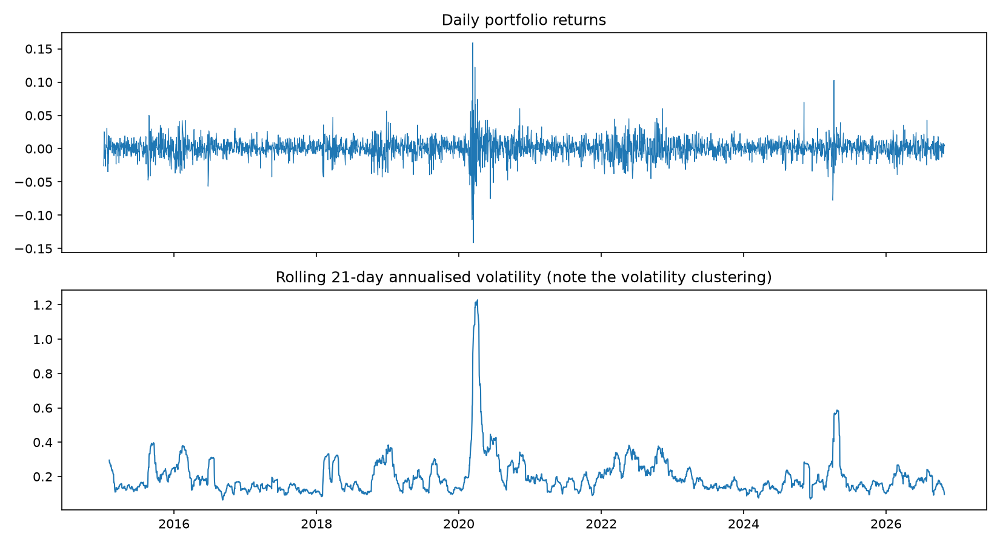
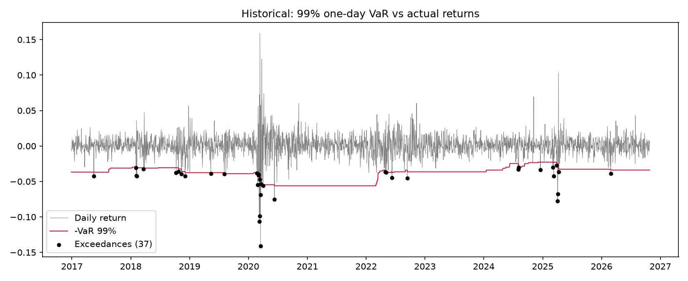
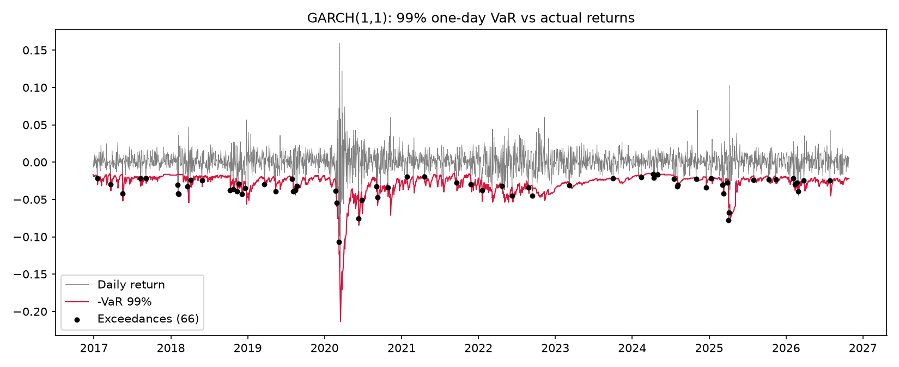

# Value-at-Risk & Volatility Analysis for a Bank-Stock Portfolio

Comparing three one-day Value-at-Risk (VaR) and Expected Shortfall (ES) models and testing which one a risk team could actually trust, using backtesting methods from the Basel framework.

## Business problem

Banks must estimate how much a trading portfolio could lose in one day, and regulators check whether those estimates hold up in practice. A model that under-predicts risk leaves the bank under-capitalised. A model that over-predicts ties up capital unnecessarily.

This project asks: **which VaR model best captures the risk of an equity portfolio, especially during volatile periods?**

## Data

- Source: Yahoo Finance via `yfinance` (public, free to use)
- Default portfolio: equal-weighted JPM, GS, BAC, MSFT, AAPL
- Period: 5 Jan 2015 to 27 Oct 2026 (2,971 daily returns). The first 500 days form the initial estimation window, leaving **2,471 days** for backtesting
- Prices are cached locally to `prices.csv` after the first download (not committed to the repo)

## Methods

| Model | Idea | Weakness |
|---|---|---|
| Historical simulation | Use the empirical distribution of the last 500 returns | Slow to react when volatility changes |
| Parametric (Normal) | Assume returns are normally distributed | Underestimates fat tails |
| GARCH(1,1) | Forecast time-varying volatility, then convert to VaR | Still assumes normal innovations |

- Forecasts are **rolling and one-day-ahead**: the VaR for day *t* uses only data before day *t*, so there is no look-ahead bias.
- GARCH is re-fitted every 21 trading days (about monthly) for speed.
- Evaluated at **95% and 99%** confidence.

### Backtesting

- **Exceedance count:** how often the actual loss exceeded the VaR, compared with the expected rate
- **Kupiec test:** is the exceedance *rate* correct? (p < 0.05 rejects the model)
- **Christoffersen test:** are exceedances *clustered*? (p < 0.05 means the model reacts too slowly to volatility)
- **Basel traffic-light zone:** defined for 99% VaR over the most recent 250 days (green / yellow / red)

## Results

### 99% confidence (2,471 backtest days)

| Model | Expected exceedances | Actual exceedances | Exceedance rate | Kupiec p-value | Christoffersen p-value | Avg VaR | Avg ES | Basel zone (last 250 days) |
|---|---|---|---|---|---|---|---|---|
| Historical | 24.7 | 37 | 1.50% | 0.0206 | 0.0019 | 3.83% | 5.39% | green |
| Parametric (Normal) | 24.7 | 58 | 2.35% | <0.0001 | <0.0001 | 3.25% | 3.74% | green |
| GARCH(1,1) | 24.7 | 66 | 2.67% | <0.0001 | 0.3823 | 2.82% | 3.25% | yellow |

### 95% confidence (2,471 backtest days)

| Model | Expected exceedances | Actual exceedances | Exceedance rate | Kupiec p-value | Christoffersen p-value |
|---|---|---|---|---|---|
| Historical | 123.6 | 123 | 4.98% | 0.9595 | 0.0001 |
| Parametric (Normal) | 123.6 | 110 | 4.45% | 0.2029 | <0.0001 |
| GARCH(1,1) | 123.6 | 148 | 5.99% | 0.0284 | 0.0203 |

Charts (generated into `results/`):





### Key findings

- **No model fully passes at 99%.** A well-calibrated 99% model should be breached about 25 times in 2,471 days. Historical simulation was closest (37 breaches) and only marginally rejected by the Kupiec test (p = 0.02). The Parametric (58) and GARCH (66) models were clearly rejected.
- **The Normal assumption understates tail losses.** The Parametric model's average 99% Expected Shortfall was 3.7%, compared with 5.4% for Historical simulation, so it underestimates how bad the worst days are.
- **GARCH reacts to changing volatility but still breaches too often.** It was the only model whose breaches were not clustered (Christoffersen p = 0.38), yet it had the most breaches. This suggests the weak point is the Normal-distribution assumption rather than the volatility forecast.
- **At 95% confidence the picture changes.** Historical and Parametric matched the expected breach rate (Kupiec p = 0.96 and 0.20), but their breaches were clustered, meaning they were slow to respond in volatile periods.

**Takeaway:** for this portfolio, a risk team should not rely on a Normal-distribution VaR at 99%. Historical simulation was the most reliable on breach count, and the results point towards a volatility model with fat-tailed errors as the natural next improvement.

## How to run

```bash
conda env create -f environment.yml
conda activate var-risk
python var_analysis.py
# optional: choose your own portfolio
python var_analysis.py --tickers JPM GS BAC --start 2012-01-01 --window 500
```

Outputs are written to `results/`. Results will change slightly depending on the date you run it, because the data runs up to the present day.

## Project structure

```
var_analysis.py      # data, risk models, backtesting and plots
environment.yml      # conda environment
results/             # charts and backtest_summary.csv
README.md
```

## Limitations and next steps

- Fixed equal weights, with no transaction costs or rebalancing effects
- GARCH uses normal innovations; a Student-t distribution would better capture fat tails
- Single portfolio and a single time period
- The Basel zone only looks at the last 250 days, so it says little about the full period
- Next steps: GARCH with Student-t errors, filtered historical simulation, stress testing on 2008 and 2020, a Monte Carlo VaR model

## Disclaimer

Educational project using public market data. Not investment advice.
## Data source

Daily adjusted close prices from Yahoo Finance, downloaded with the open-source [`yfinance`](https://github.com/ranaroussi/yfinance) library for educational use. Raw price data is not redistributed in this repo; it is downloaded when the script runs. This project is not affiliated with Yahoo or any of the companies analysed.
